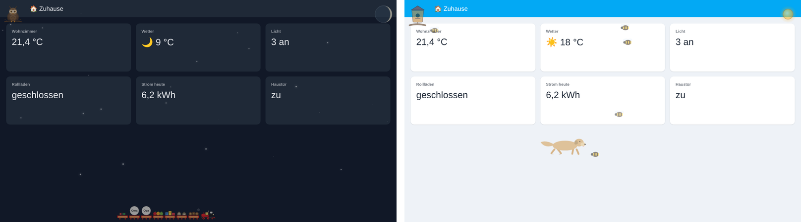
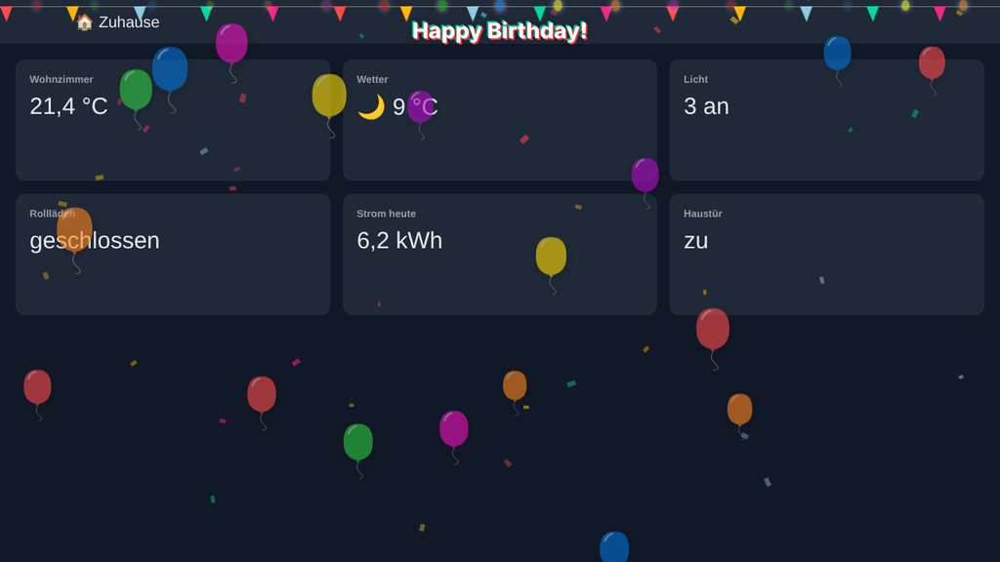
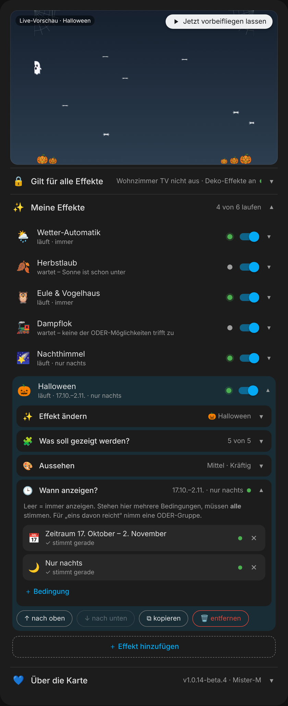
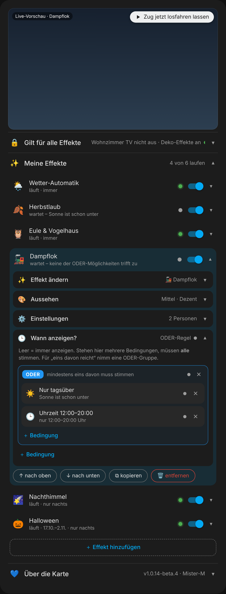

# 🌙 Ambient Overlay Card for Home Assistant

🇩🇪 **Deutsch?** → [README auf Deutsch](README.md)

**Atmosphere for your dashboard.** The card lays small animations over the whole dashboard: real weather, moon and stars, a steam train with your family as wagons, a Labrador, an owl, birthday balloons and much more. Everything runs on CSS, is easy on the battery and pauses when the dashboard is in the background.

One click opens it right in your Home Assistant: [](https://my.home-assistant.io/redirect/hacs_repository/?owner=misterm2310&repository=ambient-overlay-card&category=plugin)

> ℹ️ The card's editor is in **German**. This page explains every part of it in English, with the German labels in brackets so you can find them.



<details><summary>🎂 See the birthday mode</summary>



</details>

<details><summary>🧺 See the “all in one card” editor</summary>




</details>

---

## ✨ What can it do?

- 🌦️ **Real weather** from your `weather.*` entity: rain, snow, lightning, fog, sun – plus a 🌙 moon with the real moon phase.
- 🚂 **Steam train** with your family as wagons (only who is home), guests and a tail car.
- 🐕 **Animals:** Labrador, 🦉 owl & birdhouse, 🕷️ spider.
- 🍂 **Seasons** by themselves: blossoms, bees, leaves, tiny icicles.
- 🎉 **Holidays** by themselves: Halloween, St. Martin, St. Nicholas, Santa, New Year’s Eve, Valentine’s Day, Easter – plus 🎂 birthday and 🌠 night sky.
- 🧺 **All in one card** with “🕒 When to show?” to tap instead of YAML.
- 🔋 **Battery-friendly** via CSS, pauses in the background, light & dark by itself.

**9 effects to choose from** plus the weather automation with 10 more (rain, snow, hail, lightning, fog, storm, clouds, stars, sun, moon). Either everything in **one card** as a list – or one card per effect as before, e.g. weather automation **and** steam train **and** owl on the same view.

<details><summary>📋 All features in detail</summary>

| Feature | How it works |
|---|---|
| 🌦️ **Weather automation** | The card watches your `weather.*` entity and shows the matching effect by itself: rain, snow, hail, lightning, fog, storm, clouds, stars or sun. With “snowy-rainy” you get snow **and** rain at once, with “lightning-rainy” lightning **and** rain. |
| 🌙 **Moon with real moon phase** | Appears top right as soon as the sun is down – also together with rain or snow. The phase is calculated from the date, no sensor needed. During the day, on “sunny”, the ☀️ sun sits there instead. |
| 🚂 **Steam train** | Drives along the bottom: engine with steam, lit windows and a “TOOT”. Four wagons with everyday cargo – switchable to 🎅 Christmas or 🍽️ dinner. Very rarely the steam turns into a heart. |
| 👥 **Family on the train** | Every selected person who is currently **at home** gets their own wagon with their profile picture. Plus 🎟️ guest wagons from a sensor (e.g. “Grandma, Grandpa”) and a 🚦 blinking last wagon. |
| 🐕 **Golden Labrador** | Walks with real leg movement, wags, sniffs for a moment and leaves paw prints. If your weather entity says rain, he shakes himself dry. |
| 🦉🐦 **Owl & birdhouse** | Top left: the birdhouse with visitors during the day, at night the owl that blinks and turns its head. Switches via `sun.sun`. |
| 🌠 **Night sky** | Shooting stars, a wishing star and a rare comet – each part can be switched on or off. |
| 🎂 **Birthday mode** | Balloons, confetti, bunting with your own text (adjustable height) and fairy lights – each part can be switched on or off. |
| 🍂 **Seasons** | Changes by itself: 🌸 spring = blossoms in pink, white and lilac · 🐝 summer = bees · 🍂 autumn = leaves blowing through now and then · 🧊 winter = tiny icicles along the top (with drops) and glittering ice crystals. The season comes from the sensor of the HA “Season” integration – without a sensor the effect stays empty. Each season can be switched off. |
| 🎉 **Holidays** | Each holiday only on its days, each one can be switched off: 🎃 Halloween (Oct 29–31 or via a switch: pumpkins, ghost, witch, cobwebs, bats – each part on its own) · 🏮 St. Martin (Nov 10–11: lantern parade at the bottom, behind the train) · 👢 St. Nicholas (Dec 5–6: filled boots in the bottom corners) · 🎅 Santa (only while your Christmas switch is on) · 🎆 New Year’s Eve (Dec 31–Jan 1: fireworks in the upper half) · 💕 Valentine’s Day (Feb 13–14: rising hearts) · 🐰 Easter (Palm Sunday to Easter Monday, calculated by the card: grass with eggs and a hopping bunny, behind the train). |
| 👻 **Halloween look** | On 31 October all by itself (or via a switch): train with pumpkins, cauldron, coffin and sweets, Labrador with little devil horns, owl with a witch’s hat, birdhouse with a pumpkin and a cobweb (the bird wears a tiny witch’s hat) and an orange moon (in its real moon phase). |
| 🕷️ **Spider** | A spider in its web (loses its grip for a moment and then acts as if nothing happened). |
| ☃️ **Growing snow layer** | If it snows for a while, a thin layer of snow slowly builds up at the bottom. |
| 🥶 **Frosty edges** | Below 0 °C outside, the edges of the screen ice over – the colder, the stronger. Runs in the weather automation whatever the weather. |
| 🌫️ **Soft, not hard** | When the weather changes by itself, the old effect fades out gently. |
| 🧺 **All in one card** | All effects in one single card, each with its own **“🕒 When to show?”** – tap instead of YAML: only at night, period of the year, time of day, switch, person at home, weather … plus OR/AND groups. Green and grey dots show what is running right now and why something is waiting. |
| 👁️ **Editor with live preview** | Effects as tiles to tap, collapsible sections, toggle switches and the same entity search as in Home Assistant. A preview at the top with a “▶ Let it fly past now” button – no need to wait minutes for the witch, train or dog. |
| 🌗 **Light & dark** | The card detects the theme by itself, even if it is only set on a single dashboard view. |
| 🔋 **Battery friendly** | Almost everything runs on CSS (GPU). When the tab is in the background, the animations pause. |
| 🎯 **Always on top** | The effects live in their own layer above everything – even above other cards with their own animations. |

</details>

---

## 📦 Installation

1. Open **HACS** (from Home Assistant 2026.11: **Settings → Marketplace**) → top right **⋮ → Custom repositories**.
2. Enter `https://github.com/misterm2310/ambient-overlay-card`, type **Dashboard** (formerly “Lovelace”), **Add**.
3. Search for **Ambient Overlay Card**, **Download**.
4. Reload the dashboard (`Ctrl` + `F5`).
5. Dashboard → **Edit → Add card → Ambient Overlay Card**. 🎉

```yaml
type: custom:ambient-overlay-card
effects:
  - event: weather_auto
    weather_entity: weather.home
  - event: owl_birdhouse
```

> 💡 Everything looks the same after an update? That is almost always the browser cache. In the app, pull down once; in the browser press `Ctrl` + `Shift` + `R`.

> 🧪 **Testing beta versions:** In HACS, switch on **“Show beta versions”** for the card. HACS will then also offer pre-releases (e.g. `1.0.10-beta.1`). If you leave it off, you only get finished versions.

<details><summary>Without HACS (manually)</summary>

1. Download `ambient-overlay-card.js` from the latest [release](https://github.com/misterm2310/ambient-overlay-card/releases).
2. Copy it to `/config/www/ambient-overlay-card.js`.
3. **Settings → Dashboards → ⋮ → Resources → Add resource**: URL `/local/ambient-overlay-card.js`, type **JavaScript module**.
4. Reload the dashboard.
</details>

<details><summary>🔄 Switching from the old “Weather & Event Overlay Card”</summary>

The card used to be called **Weather & Event Overlay Card** (`weather-event-overlay-card`). Change three things:

1. **Resource:** remove the old URL (`/local/weather-event-overlay-card.js`) and add the new one (`/local/ambient-overlay-card.js`). With HACS, remove the old repository and add the new one.
2. **Cards:** change `type: custom:weather-event-overlay-card` to `type: custom:ambient-overlay-card`.
3. **Reload:** `Ctrl` + `Shift` + `R`.

All other options (`event`, `count_preset`, `person_entities` …) stay the same.

**Merged effects** – the old `event` values no longer work:

| Old | New |
|---|---|
| `owl`, `birdhouse` | `owl_birdhouse` (switches by itself with the sun) |
| `shooting_stars`, `wishstar`, `comet` | `night_sky` (parts can be switched off one by one) |
| `balloons`, `lights` | `birthday` (parts can be switched off one by one) |
| `rain`, `snow`, `hail`, `lightning`, `fog`, `storm`, `clouds` | `weather_auto` – only run via the weather automation |
| `gnome_door` | removed |
</details>

---

## 👆 Setting it up

<details><summary>The editor step by step: preview, effect, look, settings – <i>expand</i></summary>

Add card → **Ambient Overlay Card** → in the editor. A new card starts with **one** effect. If you want several, tap **“🔀 In Liste umwandeln”** (convert to list) at the bottom – see “All in one card” right below.

1. **▶ Preview (Live-Vorschau):** at the top you see the effect live. If a figure only comes by rarely (witch, train, dog, Santa …), send it off right away with **“▶ Jetzt vorbeifliegen lassen”**.
2. **✨ Effect (Effekt):** tap a tile – the selection then closes by itself. Tapping the row opens it again. The pure weather effects are deliberately not listed one by one – the **🌦️ weather** automation does that.
3. **🧩 What to show? (Was soll gezeigt werden?)** (birthday, night sky, seasons and holidays): every part has its own toggle. For the birthday you also enter the bunting text here and get a number field for the height of the text (in pixels). For the holidays, the Halloween parts follow below. If today is no holiday, the preview shows the next one.
4. **🎨 Appearance (Aussehen):** amount (Wenig/Mittel/Viel = low/medium/high), opacity (Zart/Dezent/Kräftig = soft/subtle/strong) and for some effects the colour.
5. **⚙️ Settings (Einstellungen)** – depending on the effect:
   * **🌦️ Weather:** your `weather.*` entity (without it the section shows a red “Wetter fehlt!” = weather missing).
   * **🐕 Labrador:** optionally the weather entity for shaking in the rain.
   * **🚂 Steam train:** Christmas, dinner and Halloween switches, people to tap, guest sensor or fixed guest text. If several switches are on: Christmas beats dinner beats Halloween.
   * **🍂 Seasons:** the season sensor (“Season” integration, reports `spring`/`summer`/`autumn`/`winter`). Without it the section shows a red “Sensor fehlt!” (sensor missing) and the effect stays empty.
   * **🎉 Holidays:** the Christmas switch (without it Santa never comes) and the Halloween switch (Halloween also outside Oct 29–31).
   * **🎃 Halloween switch** also exists for the steam train, Labrador, owl & birdhouse and the weather automation (for the moon). Without a switch the Halloween look only appears on 31 October. Found are `input_boolean.`, `binary_sensor.` and `switch.`.
6. **🕒 When to show? (Wann anzeigen?)** When the effect is visible (empty = always) – building blocks see below.
7. **💙 About the card (Über die Karte):** version, links and donate button.

Next to many settings there is a small **ⓘ** – tap it for a short explanation. On the right of every row you see a summary, even when the section is closed.

Good to know:
* For **dog, steam train, birdhouse and comet**, “amount” does not mean *how many* but *how often* something comes by.
* For **seasons and holidays** it depends on the part: leaves, lantern parade, Easter bunny, Santa, witch and ghost = *how often*; blossoms, bees, ice crystals, pumpkins, bats, rockets, hearts, eggs and stars = *how many*.
* For **clouds and birthday**, “amount” is a normal quantity.
* There is only one **spider**, so it has no amount setting.
* **Dog, steam train, owl & birdhouse, seasons, holidays and birthday** have fixed colours, so no colour mode.

</details>

<details><summary><b>🧺 All in one card (list) with “When to show?”</b></summary>

Instead of creating a separate card with visibility rules for every effect, you put **all effects into one single card**. On a single card, tap **“🔀 In Liste umwandeln”** (convert to list) at the bottom – your effect stays in with all its settings.

* **✨ My effects (Meine Effekte):** every row is one effect with a **green dot** (running right now) or a **grey dot** plus the reason (“wartet – Sonne ist noch oben” = waiting – the sun is still up). The switch turns it off without deleting it. Tapping it opens it: inside are the same sections as on a single card, plus ↑ ↓, copy and remove (with a safety question).
* **🕒 When to show? (Wann anzeigen?)** – per effect. Empty = always. Ready-made building blocks to tap: *only at night (Nur nachts), only during the day (Nur tagsüber), period of the year (Zeitraum im Jahr, e.g. 17 Oct – 2 Nov, every year), time from–to (Uhrzeit von–bis, also only on certain weekdays), switch is on (Schalter ist an), person is at home (Person ist zuhause), weather is … (Wetter ist …)* and *custom condition (Eigene Bedingung)* for any entity.
* **Groups:** several conditions below each other must **all** be true. For “one of them is enough” there is the blue **ODER** (OR) group, the green **UND** (AND) group means “all of them”. Groups can be nested; tapping ODER/UND switches between them.
* **🔒 Applies to all effects (Gilt für alle Effekte):** conditions for the whole card – e.g. “only when the TV is on”. If something here is not true, nothing is shown at all.
* **Choosing a state:** for “custom condition” and “weather is …” you get Home Assistant’s own picker with all states of the device (several = one of them is enough). If HA does not load it, the states appear as buttons to tap.
* **Preview:** shows everything that is running right now (“5 von 11 laufen gerade” = 5 of 11 running) – or only the effect you opened, even if it is waiting.
* If an entity is missing (renamed, deleted), only that effect pauses and shows a red **“⚠️ … nicht gefunden”** (not found). Everything else keeps running.

The conditions use the same format as Home Assistant’s visibility (`state`, `numeric_state`, `time`, `screen`, `user`, `and`, `or`) – so you can copy your old visibility rules 1:1. New is `period` for a period of the year.

```yaml
type: custom:ambient-overlay-card
conditions:                      # 🔒 applies to all effects
  - condition: state
    entity: input_boolean.deco_effects
    state: "on"
effects:
  - event: weather_auto
    weather_entity: weather.home
  - event: holidays
    conditions:                  # 🕒 When to show?
      - condition: state         # only at night
        entity: sun.sun
        state: below_horizon
  - event: train
    person_entities: person.anna, person.ben
    conditions:
      - condition: or            # one of them is enough
        conditions:
          - condition: state
            entity: sun.sun
            state: above_horizon
          - condition: time
            after: "12:00:00"
            before: "20:00:00"
  - event: dog
    enabled: false               # switched off for now
```

**And my old cards?** They keep working exactly as before – you don’t have to change anything. The single card now also has “🕒 When to show?”.

</details>

<details><summary><b>🚃 Order of the wagons</b></summary>

From front to back: **engine** → the **four fixed wagons** → the **people** (in the order you selected them) → the **guests** (as the names are in the sensor) → at the very end the **last wagon** with the blinking lights.

</details>

<details><summary><b>🌦️ What the weather automation shows</b></summary>

| Weather in Home Assistant | Effect |
|---|---|
| `rainy`, `pouring` | 🌧️ Rain |
| `snowy` | ❄️ Snow (with growing snow layer) |
| `snowy-rainy` | ❄️ Snow **+** 🌧️ rain |
| `hail` | 🧊 Hail |
| `lightning` | ⚡ Lightning |
| `lightning-rainy` | ⚡ Lightning **+** 🌧️ rain |
| `fog` | 🌫️ Fog |
| `windy`, `windy-variant` | 💨 Storm |
| `cloudy`, `partlycloudy` | 🌤️ Drifting clouds |
| `clear-night` | ✨ Starry sky |
| `sunny` | ☀️ Sun (only during the day) |
| anything else | off |

**Always on top of that:** once the sun has set (`sun.sun` = `below_horizon`), the 🌙 moon is added – whatever the weather. The sun then disappears, even if the weather entity still says “sunny” (both sit in the same spot).

**And when it freezes:** below 0 °C the 🥶 screen edges ice over – whatever the weather. The colder, the wider the ice (4 steps: down to -3 °C, -6 °C, -10 °C, below that full strength). The temperature comes from the weather entity or from your own `temperature_entity` (e.g. your weather station). To switch it off: `frost_edges: false`, or in the editor under ⚙️ Settings („Einstellungen“ → „Frost-Ränder“).

Amount, opacity and colour mode apply to **all** weather effects together in the automation. Animals and decoration do not run via the automation – just add them as another effect to the list.

</details>

---

## 🧩 The effects

| `event` | What happens |
|---|---|
| `off` | No effect (default) |
| `weather_auto` | 🌦️ Automatic, based on the real weather (see above) |
| `night_sky` | 🌠 Shooting stars, wishing star and comet |
| `owl_birdhouse` | 🦉🐦 Birdhouse by day, owl by night |
| `birthday` | 🎂 Balloons, confetti, bunting with text, fairy lights |
| `seasons` | 🍂 Seasons: blossoms, bees, leaves, icicles – changes by itself |
| `holidays` | 🎉 Holidays: Halloween, St. Martin, St. Nicholas, Santa, New Year’s Eve, Valentine’s Day, Easter |
| `train` | 🚂 Steam train with wagons, family, guests and last wagon |
| `dog` | 🐕 Golden Labrador (optionally shaking in the rain) |
| `spider` | 🕷️ Spider in its web with red eyes |

> **⚠️ Switching over from version 1.0.19:** `leaves`, `bee`, `halloween` and `santa` no longer exist as effects of their own. If your card still uses one of them, it stays empty. Leaves and bees now live in **🍂 Seasons** (`seasons`), Halloween and Santa in **🎉 Holidays** (`holidays`). In the editor just tap the new tile – your Halloween parts (`halloween_bats` etc.) and your Christmas switch (`santa_sensor`) still apply.

<details><summary>📋 YAML examples</summary>

**Steam train with family, guests and holiday switches**
```yaml
type: custom:ambient-overlay-card
event: train
count_preset: medium
opacity_preset: high
santa_sensor: input_boolean.christmas_time
dinner_sensor: input_boolean.dinner
person_entities: person.anna, person.ben
custom_wagon_entity: input_text.guests
```

**Steam train with fixed guest wagons (no sensor)**
```yaml
type: custom:ambient-overlay-card
event: train
custom_wagon_text: Grandma, Grandpa
```

**Labrador who shakes himself in the rain**
```yaml
type: custom:ambient-overlay-card
event: dog
opacity_preset: high
weather_entity: weather.home
```

**Owl & birdhouse** (`count_preset` = how often a bird flies by)
```yaml
type: custom:ambient-overlay-card
event: owl_birdhouse
opacity_preset: high
```

**Birthday with your own text**
```yaml
type: custom:ambient-overlay-card
event: birthday
birthday_text: "Happy Birthday, Max!"
birthday_text_top: 120   # text a bit further down
opacity_preset: high
```

**Holidays – with Christmas switch, Halloween without bats, no Valentine’s Day**
```yaml
type: custom:ambient-overlay-card
event: holidays
opacity_preset: high
santa_sensor: input_boolean.christmas_time
halloween_bats: false
holiday_valentin: false
```

**Seasons with the Season sensor, but without summer bees**
```yaml
type: custom:ambient-overlay-card
event: seasons
season_entity: sensor.season
season_summer: false
```

**Halloween train from mid-October (via a switch)**
```yaml
type: custom:ambient-overlay-card
event: train
halloween_sensor: input_boolean.halloween
```

**Night sky – only the comet**
```yaml
type: custom:ambient-overlay-card
event: night_sky
count_preset: low
opacity_preset: high
night_shooting_stars: false
night_wishstar: false
night_comet: true
```

**Spider**
```yaml
type: custom:ambient-overlay-card
event: spider
color_mode: auto
```

**Autumn leaves with your own colours** (YAML only)
```yaml
type: custom:ambient-overlay-card
event: seasons
leaf_colors:
  - "#c9a227"
  - "#a83232"
  - "#d9812c"
```
</details>

---

## 🎛️ Card options

<details><summary>Everything works in the editor – this is for YAML fans – <i>expand</i></summary>

| Option | Default | What does it do? |
|---|---|---|
| `event` | `off` | Which effect runs (see table above) |
| `count_preset` | `medium` | `low`, `medium` or `high` – how many or how often |
| `opacity_preset` | `medium` | `low`, `medium` or `high` – how strong. With `high` every effect gets noticeably stronger |
| `color_mode` | `auto` | `auto` = matching the theme, `custom` = fixed colour |
| `color` | `auto` | your own colour (hex) for the night sky, spider web and weather effects |
| `weather_entity` | – | `weather.*` entity for the automation, and for the dog’s shaking |
| `frost_edges` | `true` | Weather automation: 🥶 frosty edges below 0 °C on/off |
| `temperature_entity` | – | Weather automation: your own temperature sensor for the frost (°C or °F). Empty = temperature from `weather_entity` |
| `birthday_text` | `Happy Birthday!` | Text on the bunting (protected against malicious code) |
| `birthday_text_top` | `26` | Height of the text: distance from the top edge in pixels (0–600). The bunting stays at the top |
| `birthday_balloons` / `birthday_confetti` / `birthday_banner` / `birthday_lights` | `true` | Parts of the birthday mode on/off |
| `night_shooting_stars` / `night_wishstar` / `night_comet` | `true` | Parts of the night sky on/off |
| `season_entity` | – | Seasons: sensor of the “Season” integration (`spring`/`summer`/`autumn`/`winter`). Required – without a sensor the effect stays empty |
| `season_spring` / `season_summer` / `season_autumn` / `season_winter` | `true` | Seasons on/off one by one |
| `holiday_halloween` / `holiday_martini` / `holiday_nikolaus` / `holiday_christmas` / `holiday_silvester` / `holiday_valentin` / `holiday_easter` | `true` | Holidays on/off one by one |
| `santa_sensor` | – | Switch (`input_boolean`/`binary_sensor`/`switch`): on = Christmas cargo on the train, or for holidays: Santa flies |
| `dinner_sensor` | – | Switch: on = dinner cargo on the train (Christmas wins) |
| `halloween_pumpkins` / `halloween_ghost` / `halloween_witch` / `halloween_webs` / `halloween_bats` | `true` | Holidays: Halloween parts on/off one by one |
| `halloween_sensor` | – | Switch: on = Halloween look for train, dog, owl and moon (otherwise only on 31 October); for holidays: Halloween also outside Oct 29–31 |
| `person_entities` | – | `person.` entities separated by commas – whoever is at home rides along (tap to select in the editor) |
| `custom_wagon_entity` | – | Sensor with names separated by commas, e.g. `input_text.guests` – one wagon per name. Empty, `unknown` or `unavailable` = no guest wagons. Wins over the fixed text |
| `custom_wagon_text` | – | fixed text for guest wagons, e.g. `Grandma, Grandpa` |
| `leaf_colors` | `["#c9a227", "#a83232", "#d9812c"]` | three hex colours for the leaves (YAML only) |
| `leaf_shape` | built-in shape | your own leaf shape as an SVG path (YAML only, checked for safety) |
| `conditions` | – | 🕒 When to show? A list of conditions (same format as HA visibility, plus `period` with `from`/`to` as `"MM-DD"`). In a list card: at the top = applies to all, inside an effect = only for that one |
| `effects` | – | turns the card into a list: each entry has the same options as above, plus `conditions` and `enabled: false` to switch it off |

</details>

---

## ❓ FAQ

**Can I switch off the Halloween look on 31 October?** Not at the moment – on that day it comes automatically. The Halloween decoration with pumpkins, witch & co. only comes with **🎉 Holidays** – there you can switch Halloween off completely.

**Where does the season sensor come from?** From the Home Assistant **“Season”** integration (Settings → Devices & services → Add integration → “Season”). Choose “meteorological” (changes on 1 March, 1 June …) or “astronomical” (on the 20th/21st). Without a sensor the effect shows nothing.

**Can I have several effects at the same time?** Yes – easiest with **“all in one card”** (see above). Several single cards still work too.

**How do I hide all effects at once?** In a list card via **🔒 Applies to all effects**, e.g. with an `input_boolean`. The card’s normal **visibility** in Home Assistant works as well.

**Is it heavy on my tablet?** Hardly. Almost everything runs on CSS, and in background tabs everything pauses. On very weak devices just use `low` for `count_preset`.

**Is it safe?** The birthday text and custom leaf shapes are checked before they are shown. The card sends nothing to the internet.

**Is there an English editor?** Not yet – the editor is in German. This page translates every label so you can find your way around.

---

## 💙 Do you like the card?

It is and stays **free**. If you like, you can send me a small donation via PayPal – completely voluntary: [paypal.me/MarcoStrickmann](https://paypal.me/MarcoStrickmann). The link is also in the card editor under 💙 Über die Karte (About the card). Thank you! 🙏

[](https://paypal.me/MarcoStrickmann)

---

## 💡 Ideas, wishes and bugs

- **Idea or wish?** Post it in the [discussions](https://github.com/misterm2310/ambient-overlay-card/discussions). Everyone can agree with 👍 and join in.
- **Something doesn’t work?** Open an [issue](https://github.com/misterm2310/ambient-overlay-card/issues). Helpful: your version, which effect, which device, what you did and what happened.

---

License: [MIT](LICENSE) – free to use, change and share, also commercially. Only the license text with the copyright notice has to stay with it.
