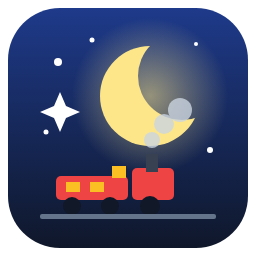
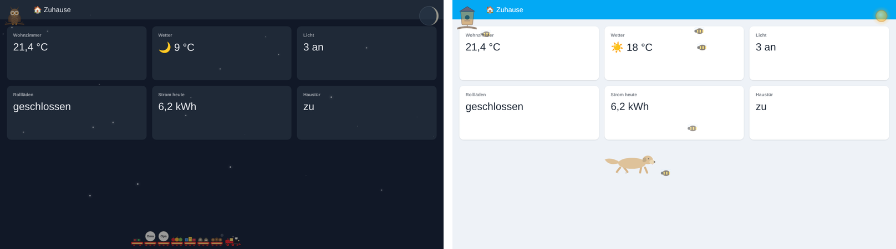
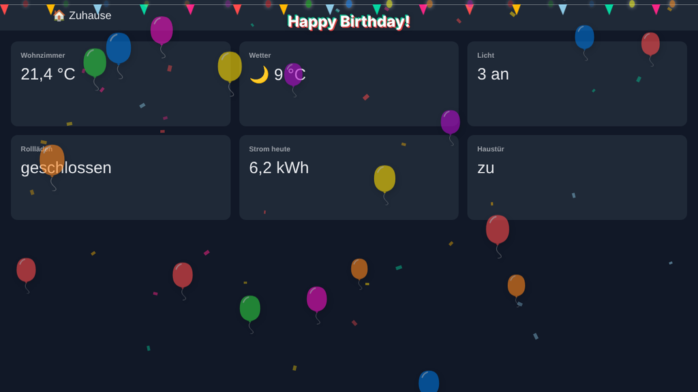

# 🌙 Ambient Overlay Card für Home Assistant

**Stimmung für dein Dashboard.** Die Karte legt kleine Animationen über das ganze Dashboard: echtes Wetter, Mond und Sterne, eine Dampflok mit deiner Familie als Waggons, einen Labrador, eine Eule, Geburtstags-Ballons und vieles mehr. Alles läuft über CSS, schont den Akku und pausiert, wenn das Dashboard im Hintergrund ist.



<details><summary>🎂 Geburtstags-Modus ansehen</summary>



</details>

---

## ✨ Was kann das Ding?

| Funktion | So klappt's |
|---|---|
| 🌦️ **Wetter-Automatik** | Die Karte schaut auf deine `weather.*`-Entity und zeigt selbst das Passende: Regen, Schnee, Hagel, Blitz, Nebel, Sturm, Wolken, Sterne oder Sonne. Bei „Schneeregen“ laufen Schnee **und** Regen gleichzeitig, bei „Gewitter mit Regen“ Blitz **und** Regen. |
| 🌙 **Mond mit echter Mondphase** | Erscheint oben rechts, sobald die Sonne weg ist – auch zusammen mit Regen oder Schnee. Die Phase wird aus dem Datum berechnet, ganz ohne Sensor. Tagsüber sitzt dort bei „sonnig“ die ☀️ Sonne. |
| 🚂 **Dampflok** | Fährt unten durchs Bild: Lok mit Dampf, beleuchteten Fenstern und „TUUT“. Vier Waggons mit Alltags-Ladung – per Schalter auf 🎅 Weihnachten oder 🍽️ Abendessen umstellbar. Ganz selten wird der Dampf zum Herz. |
| 👥 **Familie im Zug** | Jede angehakte Person, die gerade **zuhause** ist, bekommt einen eigenen Waggon mit Profilbild. Dazu 🎟️ Gäste-Waggons aus einem Sensor (z. B. „Oma, Opa“) und ein 🚦 blinkender Schlusswagen. |
| 🐕 **Goldener Labrador** | Läuft mit echter Beinbewegung, wedelt, schnüffelt kurz und hinterlässt Pfotenabdrücke. Regnet es laut Wetter-Entity, schüttelt er sich. |
| 🦉🐦 **Eule & Vogelhäuschen** | Oben links: tagsüber das Vogelhäuschen mit Besuch, nachts die Eule, die blinzelt und den Kopf dreht. Umgeschaltet wird über `sun.sun`. |
| 🌠 **Nachthimmel** | Sternschnuppen, Wunschstern und ein seltener Komet – jedes Teil einzeln an- und abwählbar. |
| 🎂 **Geburtstags-Modus** | Luftballons, Konfetti, Wimpelkette mit eigenem Text und Lichterkette – jedes Teil einzeln an- und abwählbar. |
| 🎃 **Halloween** | Flackernde Kürbis-Laternen, ein Gespenst, das „Buh!“ ruft, eine Hexe auf dem Besen (verliert ab und zu den Hut), Spinnweben und Fledermäuse – jedes Teil einzeln an- und abwählbar. |
| 👻 **Halloween-Look** | Am 31. Oktober ganz von selbst (oder per Schalter): Zug mit Kürbissen, Hexenkessel, Sarg und Süßigkeiten, Labrador mit Teufelshörnchen, Eule mit Hexenhut, Vogelhäuschen mit Kürbis und Spinnwebe (der Vogel trägt einen Mini-Hexenhut) und ein oranger Vollmond. |
| 🎅 **Weihnachtsmann** | Fliegt mit Schlitten und Rentieren vorbei und verliert ab und zu ein Geschenk. |
| 🕷️🐝🍂 **Noch mehr Tiere & Deko** | Spinne im Netz (verliert kurz den Halt und tut dann so, als wäre nichts gewesen), Bienenschwarm und Herbstlaub. |
| ☃️ **Wachsende Schneedecke** | Schneit es eine Weile, bleibt unten langsam eine kleine Schneeschicht liegen. |
| 🌫️ **Sanft statt hart** | Wechselt das Wetter von selbst, blendet der alte Effekt weich aus. |
| 👁️ **Live-Vorschau** | Der Editor zeigt oben eine kleine Vorschau und blendet nur die Regler ein, die beim gewählten Effekt etwas tun. |
| 🌗 **Hell & Dunkel** | Die Karte erkennt das Theme selbst, auch wenn es nur auf einer einzelnen Dashboard-Seite gesetzt ist. |
| 🔋 **Akku-schonend** | Fast alles läuft über CSS (Grafikkarte). Ist der Tab im Hintergrund, pausieren die Animationen. |
| 🎯 **Immer obendrauf** | Die Effekte liegen in einer eigenen Ebene über allem – auch über anderen Karten mit eigenen Animationen. |

**11 Effekte zum Auswählen** plus die Wetter-Automatik mit 10 weiteren (Regen, Schnee, Hagel, Blitz, Nebel, Sturm, Wolken, Sterne, Sonne, Mond). Pro Effekt eine Karte – du kannst also mehrere Karten gleichzeitig laufen lassen, z. B. Wetter-Automatik **und** Dampflok **und** Eule.

---

## 📦 Installation

1. **HACS** öffnen → oben rechts **⋮ → Benutzerdefinierte Repositories**.
2. `https://github.com/misterm2310/ambient-overlay-card` eintragen, Typ **Dashboard** (früher „Lovelace“), **Hinzufügen**.
3. Nach **Ambient Overlay Card** suchen, **Herunterladen**.
4. Dashboard neu laden (`Strg` + `F5`).
5. Dashboard → **Bearbeiten → Karte hinzufügen → Ambient Overlay Card**. 🎉

```yaml
type: custom:ambient-overlay-card
event: weather_auto
weather_entity: weather.home
```

> 💡 Sieht nach einem Update alles aus wie vorher? Das ist fast immer der Browser-Zwischenspeicher. In der App einmal nach unten ziehen oder im Browser `Strg` + `Shift` + `R`.

> 🧪 **Beta-Versionen testen:** In HACS bei der Karte die Option **„Beta-Versionen anzeigen“** einschalten. Dann bietet HACS dir auch Vorabversionen an (z. B. `1.0.10-beta.1`). Wer sie nicht einschaltet, bekommt nur fertige Versionen.

<details><summary>Ohne HACS (von Hand)</summary>

1. `ambient-overlay-card.js` aus dem aktuellen [Release](https://github.com/misterm2310/ambient-overlay-card/releases) herunterladen.
2. Nach `/config/www/ambient-overlay-card.js` kopieren.
3. **Einstellungen → Dashboards → ⋮ → Ressourcen → Ressource hinzufügen**: URL `/local/ambient-overlay-card.js`, Typ **JavaScript-Modul**.
4. Dashboard neu laden.
</details>

<details><summary>🔄 Umstieg von der alten „Weather & Event Overlay Card“</summary>

Die Karte hieß früher **Weather & Event Overlay Card** (`weather-event-overlay-card`). Drei Dinge anpassen:

1. **Ressource:** Alte URL (`/local/weather-event-overlay-card.js`) entfernen, neue hinzufügen (`/local/ambient-overlay-card.js`). Bei HACS das alte Repository entfernen und das neue hinzufügen.
2. **Karten:** `type: custom:weather-event-overlay-card` ändern in `type: custom:ambient-overlay-card`.
3. **Neu laden:** `Strg` + `Shift` + `R`.

Alle anderen Optionen (`event`, `count_preset`, `person_entities` …) bleiben gleich.

**Zusammengelegte Effekte** – die alten `event`-Werte gehen nicht mehr:

| Alt | Neu |
|---|---|
| `owl`, `birdhouse` | `owl_birdhouse` (wechselt selbst nach Sonnenstand) |
| `shooting_stars`, `wishstar`, `comet` | `night_sky` (Teile einzeln abwählbar) |
| `balloons`, `lights` | `birthday` (Teile einzeln abwählbar) |
| `rain`, `snow`, `hail`, `lightning`, `fog`, `storm`, `clouds` | `weather_auto` – laufen nur noch über die Wetter-Automatik |
| `gnome_door` | ersatzlos entfernt |
</details>

---

## 👆 So wird's eingerichtet

Karte hinzufügen → **Ambient Overlay Card** → im Editor:

1. Oben läuft die **Live-Vorschau** mit – einfach ausprobieren.
2. **Effekt** wählen – oder **„🌦️ Automatisch (nach Wetter)“**. Die reinen Wetter-Effekte stehen bewusst nicht einzeln in der Liste, die macht die Automatik.
3. Je nach Effekt erscheinen passende Felder:
   * **Automatisch:** deine `weather.*`-Entity auswählen.
   * **🎂 Geburtstag:** den Text für die Wimpelkette.
   * **🎃 Halloween:** Häkchen für Kürbisse, Gespenst, Hexe, Spinnweben und Fledermäuse.
   * **🐕 Labrador:** optional die Wetter-Entity fürs Schütteln bei Regen.
   * **🚂 Dampflok:** Weihnachts-Schalter, Abendessen-Schalter, Halloween-Schalter, Personen zum Anhaken, Gäste-Sensor oder fester Gäste-Text. Sind mehrere Schalter an, gilt: Weihnachten vor Abendessen vor Halloween.
   * **Halloween-Schalter** gibt's bei Dampflok, Labrador, Eule & Vogelhäuschen und der Wetter-Automatik (für den Mond). Ohne Schalter kommt der Halloween-Look nur am 31. Oktober.
4. **Anzahl / Frequenz** und **Deckkraft** nach Geschmack, bei manchen Effekten noch der **Farbmodus**.

Gut zu wissen:
* Bei **Weihnachtsmann, Hund, Dampflok, Vogelhäuschen, Komet und Laub** heißt „Anzahl“ nicht *wie viele*, sondern *wie oft* etwas vorbeikommt.
* Bei **Halloween** steuert „Anzahl“ beides: wie viele Kürbisse und Fledermäuse, und wie oft Hexe und Gespenst vorbeikommen.
* Bei **Bienen, Wolken und Geburtstag** ist „Anzahl“ eine ganz normale Menge.
* Die **Spinne** gibt es nur einmal, da gibt's keinen Anzahl-Regler.
* **Weihnachtsmann, Hund, Dampflok, Eule & Vogelhäuschen, Laub, Bienen, Geburtstag und Halloween** haben feste Farben, also keinen Farbmodus.

### 🚃 Reihenfolge der Waggons

Von vorn nach hinten: **Lok** → die **vier festen Waggons** → die **Personen** (in der Reihenfolge, wie du sie angehakt hast) → die **Gäste** (wie die Namen im Sensor stehen) → ganz hinten der **Schlusswagen** mit den blinkenden Lampen.

### 🌦️ Was die Wetter-Automatik zeigt

| Wetter in Home Assistant | Effekt |
|---|---|
| `rainy`, `pouring` | 🌧️ Regen |
| `snowy` | ❄️ Schnee (mit wachsender Schneedecke) |
| `snowy-rainy` | ❄️ Schnee **+** 🌧️ Regen |
| `hail` | 🧊 Hagel |
| `lightning` | ⚡ Blitz |
| `lightning-rainy` | ⚡ Blitz **+** 🌧️ Regen |
| `fog` | 🌫️ Nebel |
| `windy`, `windy-variant` | 💨 Sturm |
| `cloudy`, `partlycloudy` | 🌤️ Wolken-Drift |
| `clear-night` | ✨ Sternenhimmel |
| `sunny` | ☀️ Sonne (nur tagsüber) |
| alles andere | aus |

**Dazu immer:** Ist die Sonne untergegangen (`sun.sun` = `below_horizon`), kommt der 🌙 Mond dazu – egal welches Wetter. Die Sonne verschwindet dann, auch wenn die Wetter-Entity noch „sunny“ meldet (beide sitzen am selben Platz).

Anzahl, Deckkraft und Farbmodus gelten bei der Automatik für **alle** Wetter-Effekte gemeinsam. Tiere und Deko laufen nicht über die Automatik, dafür einfach eine zweite Karte anlegen.

---

## 🧩 Die Effekte

| `event` | Was passiert |
|---|---|
| `off` | Kein Effekt (Standard) |
| `weather_auto` | 🌦️ Automatisch nach echtem Wetter (siehe oben) |
| `night_sky` | 🌠 Sternschnuppen, Wunschstern und Komet |
| `owl_birdhouse` | 🦉🐦 Tags Vogelhäuschen, nachts Eule |
| `birthday` | 🎂 Ballons, Konfetti, Wimpelkette mit Text, Lichterkette |
| `halloween` | 🎃 Kürbisse, Gespenst, Hexe, Spinnweben, Fledermäuse |
| `leaves` | 🍂 Herbstwind-Stoß mit 3-Farben-Verlauf |
| `santa` | 🎅 Weihnachtsmann mit Schlitten, verliert mal ein Geschenk |
| `train` | 🚂 Dampflok mit Waggons, Familie, Gästen und Schlusswagen |
| `dog` | 🐕 Goldener Labrador (optional Schütteln bei Regen) |
| `spider` | 🕷️ Spinne im Netz mit roten Augen |
| `bee` | 🐝 Bienenschwarm im Zickzack |

<details><summary>📋 YAML-Beispiele</summary>

**Dampflok mit Familie, Gästen und Festtags-Schaltern**
```yaml
type: custom:ambient-overlay-card
event: train
count_preset: medium
opacity_preset: high
santa_sensor: input_boolean.weihnachtszeit
dinner_sensor: input_boolean.schalter_abendessen
person_entities: person.anna, person.ben
custom_wagon_entity: input_text.gaeste
```

**Dampflok mit festen Gäste-Waggons (ohne Sensor)**
```yaml
type: custom:ambient-overlay-card
event: train
custom_wagon_text: Oma, Opa
```

**Labrador, der sich bei Regen schüttelt**
```yaml
type: custom:ambient-overlay-card
event: dog
opacity_preset: high
weather_entity: weather.home
```

**Eule & Vogelhäuschen** (`count_preset` = wie oft ein Vogel vorbeifliegt)
```yaml
type: custom:ambient-overlay-card
event: owl_birdhouse
opacity_preset: high
```

**Geburtstag mit eigenem Text**
```yaml
type: custom:ambient-overlay-card
event: birthday
birthday_text: "Happy Birthday, Max!"
opacity_preset: high
```

**Halloween ohne Fledermäuse**
```yaml
type: custom:ambient-overlay-card
event: halloween
count_preset: medium
opacity_preset: high
halloween_bats: false
```

**Halloween-Zug schon ab Mitte Oktober (per Schalter)**
```yaml
type: custom:ambient-overlay-card
event: train
halloween_sensor: input_boolean.halloween
```

**Nachthimmel – nur der Komet**
```yaml
type: custom:ambient-overlay-card
event: night_sky
count_preset: low
opacity_preset: high
night_shooting_stars: false
night_wishstar: false
night_comet: true
```

**Spinne**
```yaml
type: custom:ambient-overlay-card
event: spider
color_mode: auto
```

**Bienen**
```yaml
type: custom:ambient-overlay-card
event: bee
```

**Herbstlaub mit eigenen Farben** (nur per YAML)
```yaml
type: custom:ambient-overlay-card
event: leaves
leaf_colors:
  - "#c9a227"
  - "#a83232"
  - "#d9812c"
```
</details>

---

## 🎛️ Karten-Optionen

Alles geht im visuellen Editor. Für YAML-Fans:

| Option | Standard | Was macht das? |
|---|---|---|
| `event` | `off` | Welcher Effekt läuft (siehe Tabelle oben) |
| `count_preset` | `medium` | `low`, `medium` oder `high` – wie viele bzw. wie oft |
| `opacity_preset` | `medium` | `low`, `medium` oder `high` – wie kräftig. Bei `high` wird jeder Effekt spürbar kräftiger |
| `color_mode` | `auto` | `auto` = passend zum Theme, `custom` = feste Farbe |
| `color` | `auto` | eigene Farbe (Hex) für Nachthimmel, Spinnennetz und die Wetter-Effekte |
| `weather_entity` | – | `weather.*`-Entity für die Automatik, beim Hund fürs Schütteln |
| `birthday_text` | `Happy Birthday!` | Text auf der Wimpelkette (wird gegen Schadcode abgesichert) |
| `birthday_balloons` / `birthday_confetti` / `birthday_banner` / `birthday_lights` | `true` | Teile des Geburtstags-Modus einzeln an/aus |
| `night_shooting_stars` / `night_wishstar` / `night_comet` | `true` | Teile des Nachthimmels einzeln an/aus |
| `santa_sensor` | – | Schalter (`input_boolean`/`binary_sensor`): an = Weihnachts-Ladung im Zug |
| `dinner_sensor` | – | Schalter: an = Abendessen-Ladung im Zug (Weihnachten hat Vorrang) |
| `halloween_pumpkins` / `halloween_ghost` / `halloween_witch` / `halloween_webs` / `halloween_bats` | `true` | Teile des Halloween-Modus einzeln an/aus |
| `halloween_sensor` | – | Schalter: an = Halloween-Look bei Zug, Hund, Eule und Mond. Am 31. Oktober kommt der Look auch ohne Schalter |
| `person_entities` | – | `person.`-Entities mit Komma – wer zuhause ist, fährt mit (im Editor zum Anhaken) |
| `custom_wagon_entity` | – | Sensor mit Namen und Komma, z. B. `input_text.gaeste` – pro Name ein Waggon. Leer, `unknown` oder `unavailable` = keine Gäste-Waggons. Hat Vorrang vor dem festen Text |
| `custom_wagon_text` | – | fester Text für Gäste-Waggons, z. B. `Oma, Opa` |
| `leaf_colors` | `["#c9a227", "#a83232", "#d9812c"]` | drei Hex-Farben fürs Laub (nur YAML) |
| `leaf_shape` | eingebaute Form | eigene Blattform als SVG-Pfad (nur YAML, wird sicherheitsgeprüft) |

---

## ❓ Häufige Fragen

**Kann ich den Halloween-Look am 31. Oktober abschalten?** Im Moment nicht – an dem Tag kommt er automatisch. Den Halloween-Modus selbst (`event: halloween`) gibt's dagegen nur, wenn du ihn auswählst.

**Kann ich mehrere Effekte gleichzeitig haben?** Ja. Pro Effekt eine Karte anlegen – z. B. Wetter-Automatik, Dampflok und Eule auf derselben Seite.

**Wie blende ich alle Effekte auf einmal aus?** Über die normale **Sichtbarkeit** der Karte in Home Assistant, z. B. an einen `input_boolean` gekoppelt. Die Effekte verstecken sich dann mit.

**Belastet das mein Tablet?** Kaum. Fast alles läuft über CSS, und bei Tabs im Hintergrund pausiert alles. Auf sehr schwachen Geräten bei `count_preset` einfach `low` nehmen.

**Ist das sicher?** Der Geburtstags-Text und eigene Blattformen werden geprüft, bevor sie angezeigt werden. Die Karte schickt nichts ins Internet.

---

## 💙 Gefällt dir die Karte?

Sie ist und bleibt **kostenlos**. Wenn du magst, kannst du mir ganz freiwillig eine kleine Spende per PayPal schicken: [paypal.me/MarcoStrickmann](https://paypal.me/MarcoStrickmann). Danke! 🙏

[](https://paypal.me/MarcoStrickmann)

## 💡 Ideen, Wünsche und Fehler

- **Idee oder Wunsch?** Schreib sie bei den [Diskussionen](https://github.com/misterm2310/ambient-overlay-card/discussions). Dort kann jeder mit 👍 zustimmen und mitreden.
- **Etwas funktioniert nicht?** Mach ein [Issue](https://github.com/misterm2310/ambient-overlay-card/issues) auf. Hilfreich: deine Version, welcher Effekt, welches Gerät, was du getan hast und was passiert ist.

---

Lizenz: [MIT](LICENSE) – frei verwenden, verändern und weitergeben, auch kommerziell. Nur der Lizenztext mit Urheberrechtshinweis muss dabei bleiben.
